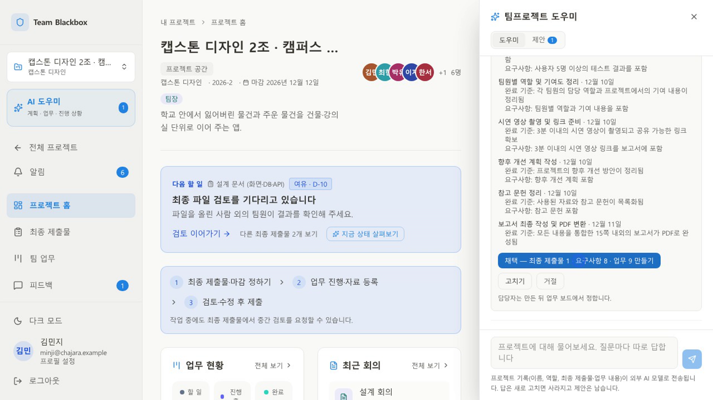
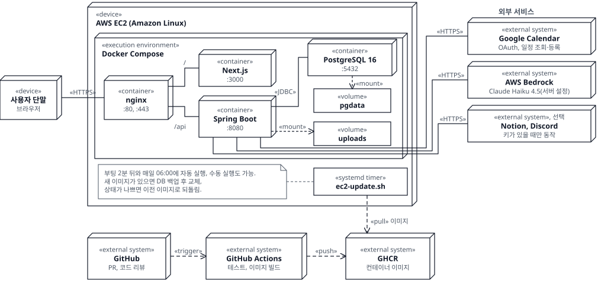

# Team Blackbox

[](https://github.com/thswjdguq/blackbox/actions/workflows/ci.yml)

대학생 팀 과제를 AI가 돕고, 서비스에 남은 진행 기록으로 팀원별 활동을 집계하는 웹 서비스입니다.

*2026 캡스톤 디자인 · 팀 "손에 송잡고"*



## 소개

팀 과제에서는 요구사항을 업무로 옮기기 어렵고, 기록이 흩어지며, 누가 무엇을 했는지 확인하기 어렵습니다.

Team Blackbox는 최종 제출물을 중심으로 과제를 끝까지 진행하게 합니다. AI는 계획과 업무를 제안하고 사람이 채택해야 반영됩니다. 사용자가 따로 입력하지 않아도 서비스에서 한 활동이 기록으로 남습니다.

## 아키텍처



- 브라우저 요청은 nginx를 거쳐 화면은 Next.js, `/api`는 Spring Boot로 갑니다.
- AI 도우미는 Spring AI로 모델과 읽기 전용 도구 6개를 호출하고, 진행 상황을 SSE로 보냅니다.
- GitHub Actions가 테스트와 이미지 빌드를 하고, 서버는 GHCR에서 이미지를 받기만 합니다.

처리 순서와 설계 판단은 [아키텍처 문서](docs/architecture.md)에 있습니다.

## 주요 기능

- **제출물과 검토:** 요구사항 관리, 파일 버전별 검토와 피드백, 조건을 통과한 최종본 확정과 수정 잠금, 제출 기록
- **AI 도우미:** 과제 안내문으로 계획 만들기, 요구사항을 업무로 나누기, 지금 상태 살펴보기, 물어보기
- **업무와 회의:** 칸반 보드, 담당자가 아닌 팀원의 완료 확인, 회의 체크인, AI 시간 추천, 회의록에서 결정사항·할 일 추출
- **기록과 보고서:** SHA-256으로 고정한 파일 기록, 팀원별 활동 집계와 경보, 활동 보고서 PDF·ZIP

전체 기능과 구현 현황은 [Use Case Diagram](docs/diagrams/usecase.svg)에 있습니다(2026-11-02 기준).

## 기술 스택

| 영역 | 기술 | 쓰는 곳 |
| --- | --- | --- |
| 백엔드 | Java 17, Spring Boot 3.5, Spring Security, JPA | REST API, JWT(HttpOnly 쿠키) 인증, 역할별 권한 |
| AI | Spring AI 1.1, AWS Bedrock(Claude Haiku 4.5), SSE | 모델 호출을 한 경계에 모아 공급자를 설정으로 교체, 진행 상황 스트리밍 |
| 데이터 | PostgreSQL 16, Flyway | 스키마 이력 관리(V1~V35), 트리거로 파일 기록 수정·삭제 차단 |
| 프론트엔드 | Next.js 16, React 18, TypeScript, Tailwind CSS, Zustand | 화면 전체, 칸반(@dnd-kit), 차트(Recharts) |
| 인프라 | AWS EC2, Docker Compose, nginx, GitHub Actions, GHCR | HTTPS 프록시, CI, 이미지 빌드, 자동 갱신과 실패 시 복구 |

## 문제 해결

| 문제 | 원인 | 해결 | 결과 |
| --- | --- | --- | --- |
| 회의록 AI 추출이 매번 502 | 모델이 JSON을 코드 블록으로 감싸 파싱 실패 | 전체를 감싼 블록만 벗기고, 근거 검사는 유지 | 실제 호출 기준 4회 모두 실패 → 2회 모두 성공 |
| 브랜치별 DB 이력이 갈라져 병합 불가 | 시연 브랜치와 main의 마이그레이션 번호·내용이 다름 | main 이력을 보존한 통합 경로, CI에서 이력 변경 검사 | 이관 시험에서 표 32개 4,477행과 파일 211개 일치 |
| 이미지가 일부만 받아져 버전이 섞일 위험 | 서비스별로 받기·태그 갱신이 따로 실패 가능 | 세 이미지가 모두 올라간 뒤 태그 갱신, 하나라도 실패하면 교체 안 함 | 교체 전 DB 백업, 상태가 나쁘면 이전 이미지로 복구 |
| 모델 응답을 기다리는 동안 연결이 끊길 위험 | 응답 전에는 SSE 이벤트가 없고 프록시가 응답을 모음 | 프록시 대기 시간과 버퍼링 설정, 서버 시간 상한 | 진행 상황을 바로 표시, 실행은 120초 안에 종료 |

사례별 과정과 근거는 [문제 해결 기록](docs/problem-solving.md)에 있습니다.

## 시작하기

Docker와 Docker Compose가 필요합니다.

```bash
cp .env.example .env    # DB_PASSWORD, JWT_SECRET(32자 이상)을 채운다
docker compose up -d --build
```

`https://localhost`로 접속합니다(자체 서명 인증서). 외부 연동 키는 비워 두면 해당 기능만 꺼집니다. 개발 환경과 환경 변수는 [개발 가이드](docs/development.md)에 있습니다.

## 팀

| 이름 | 역할 | 담당 |
| --- | --- | --- |
| 송승준 | 팀장, 백엔드 | 최종 제출물·검토·확정, 인증·권한, AI 도우미 서버, DB·배포 |
| 손정협 | 백엔드 | 업무·피드백, 진척·경보, 기여도 집계 |
| 손정효 | 프론트엔드 | 전체 화면, 화면 상태, 사용자 흐름 |

## 문서

- [아키텍처](docs/architecture.md)
- [문제 해결 기록](docs/problem-solving.md)
- [개발 가이드](docs/development.md)
- [AWS 배포](docs/deploy-aws.md)
- [팀 작업 방식과 기능 계약](docs/team/README.md)
