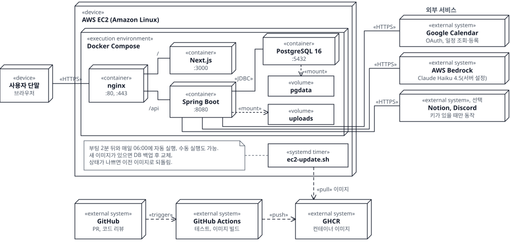
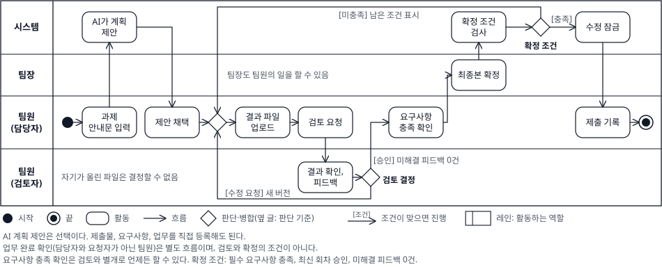
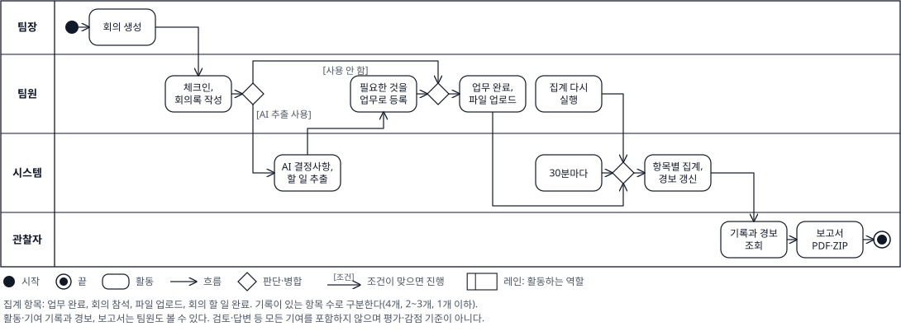
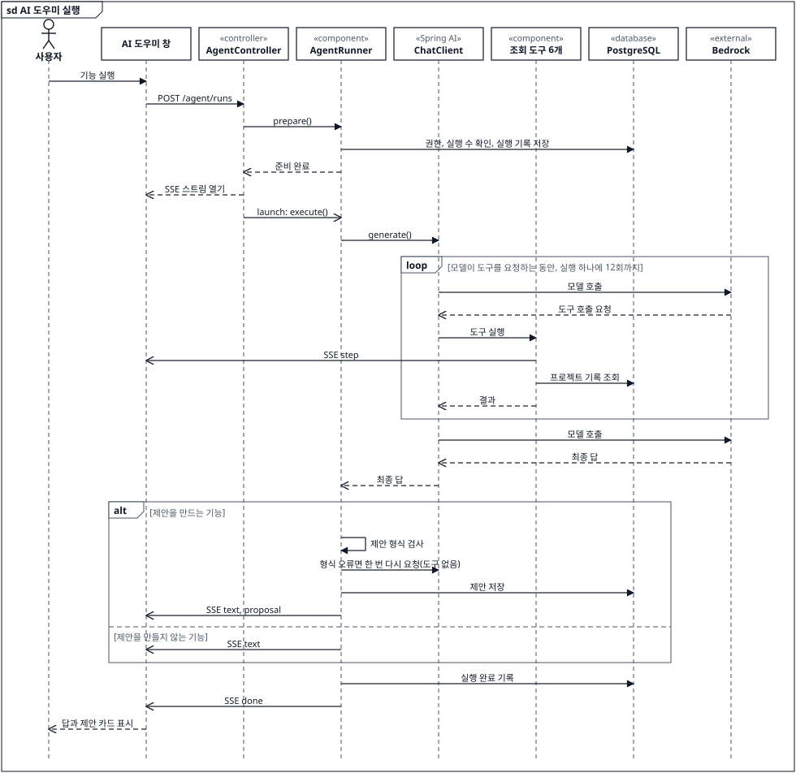
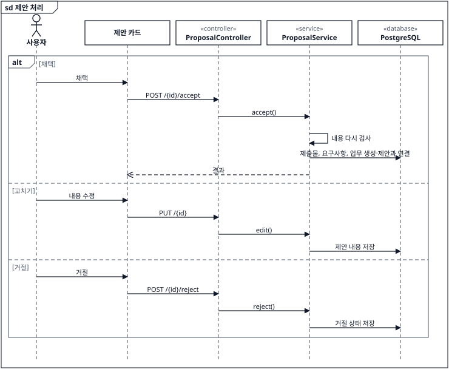
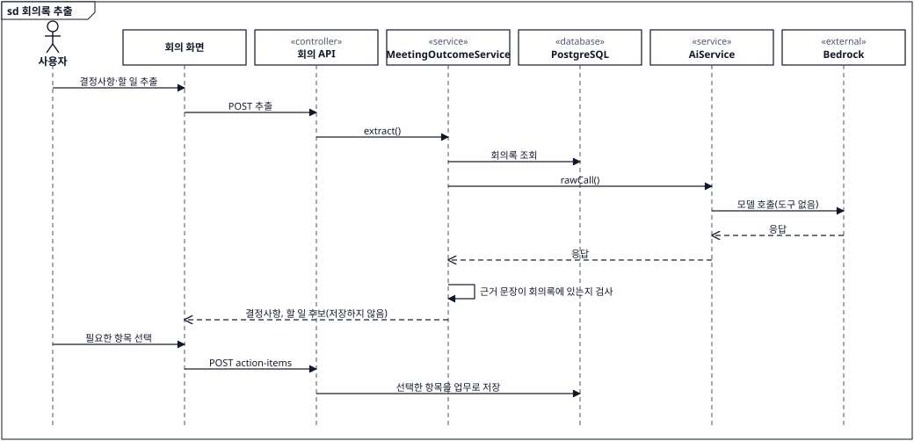

# 아키텍처

[README](../README.md)의 배치도를 자세히 설명합니다. 코드 기준은 main입니다. 그림 원본은 [`docs/diagrams/`](diagrams)의 `.drawio` 파일이며, 고친 뒤 SVG로 내보냅니다.

## 시스템 구성 (UML Deployment Diagram)

- 80포트는 443으로 넘깁니다. 브라우저는 `/api/`로 백엔드를 직접 호출하고, 나머지는 Next.js로 갑니다.
- 인증은 JWT 무상태입니다. 브라우저는 HttpOnly 쿠키로 보내고, 서버는 `Authorization: Bearer` 헤더도 받습니다.
- 서버는 이미지를 빌드하지 않습니다. 없는 태그로 띄우면 오류로 멈춥니다. 서버에 받아 둔 소스로 조용히 빌드해 다른 코드를 띄우는 일을 막기 위해서입니다.
- 부팅 2분 뒤와 매일 06:00에 자동으로 갱신합니다. 수동 갱신은 `bash ~/blackbox/scripts/ec2-update.sh`입니다([배포 문서](deploy-aws.md) 7장).

## 제출물 흐름 (UML Activity Diagram)

- 승인은 미해결 피드백이 0건일 때만 할 수 있고, 승인 뒤 추가 의견은 새 검토 회차에서 받습니다.
- 제출 기록은 학교 시스템에 직접 제출한 뒤 남기는 기록입니다. 자동 제출하지 않습니다.

## 기록과 기여도 (UML Activity Diagram)

- 사용자가 따로 입력하지 않습니다. 업무 완료 등 기록이 바뀌면 다시 집계하고, 30분마다도 전체를 집계합니다.
- 기록이 있는 항목이 1개 이하면 화면에 "집계 기록 적음"으로 표시합니다.

## AI 구조 (UML Sequence Diagram)

### AI 도우미 실행

### 제안 처리

### 회의록 추출

회의 시간 추천도 같은 `AiService`를 씁니다. 일정으로 시간 후보에 점수를 매기고, AI는 상위 3개의 추천 이유만 만듭니다.

## 설계 판단

| 판단 | 이유와 방식 |
| --- | --- |
| AI는 제안만 하고 사람이 채택 | 잘못된 결과가 바로 기록되지 않습니다. 채택할 때 내용을 다시 검사하고, 만든 항목은 전부 만들어지거나 하나도 만들어지지 않습니다. |
| 모델 호출을 한 경계에 모음 | `AgentModel`만 Spring AI를 압니다. 도구, 제안, 단계 판정은 Spring AI 타입을 모릅니다. 공급자는 설정으로 바꿉니다. |
| 도구는 읽기 전용, 프로젝트 범위 | 모델이 기록을 직접 바꾸지 못합니다. 실행 하나에 12회까지만 부를 수 있습니다. |
| 입력은 자료로만 전달 | 과제 안내문과 회의록 안의 지시를 따르지 않게 공통 지시문으로 막습니다. |
| 회의록 추출은 근거 문장 필수 | 원문에 없는 근거를 낸 항목은 후보로 보여 주지 않습니다. 추출 자체는 DB를 바꾸지 않습니다. |
| 파일 기록은 DB 트리거로 보호 | 애플리케이션 코드와 상관없이 `file_vault`의 수정과 삭제를 막습니다. |

## 모델 시험

AI 도우미 질문 세트(`AgentQuestionSetLiveTest`, 21항목)를 실제 API로 한 번씩 돌린 결과입니다(2026-10). 모델의 답은 돌릴 때마다 달라집니다. 시연 서버는 `bedrock-haiku`를 씁니다.

| 모델 | 통과 | 호출 하나에 걸린 시간 |
| --- | --- | --- |
| `bedrock-haiku` | 18 / 21 | 3~13초 |
| `bedrock-sonnet` | 19 / 21 | 4~32초 |
