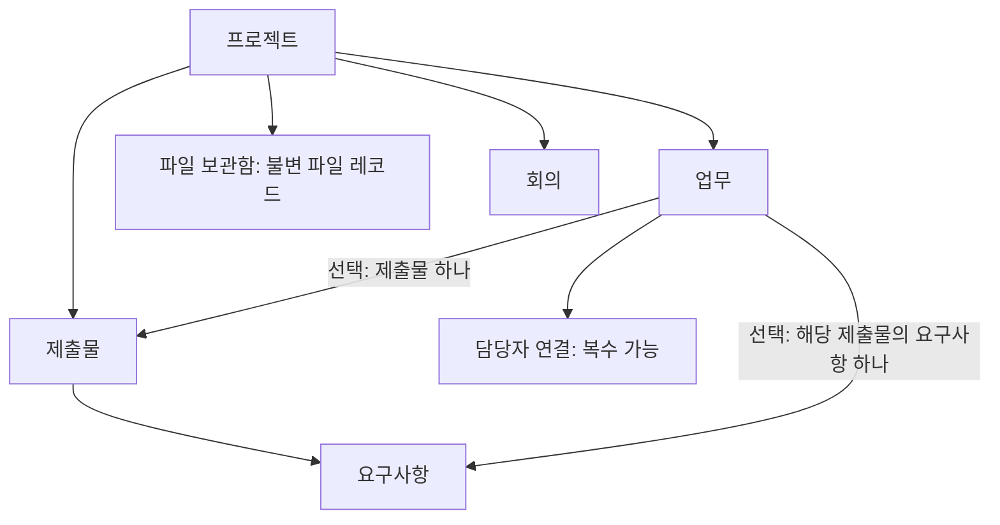
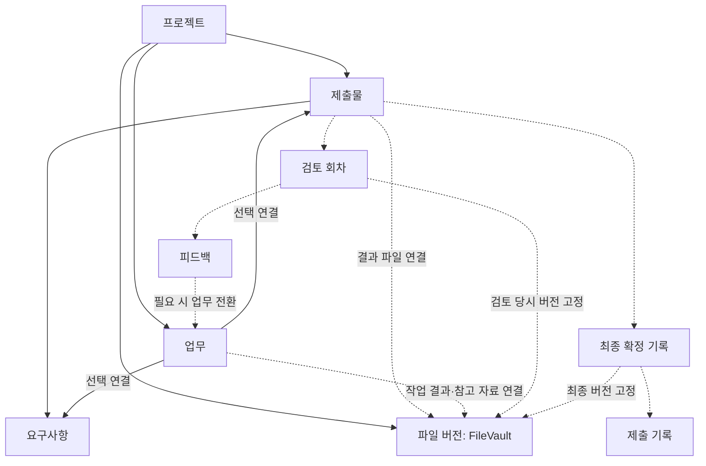

# Team Blackbox 아티팩트 관계 적용안

작성: 2026-10-12 / 상태: DRAFT — 제품 관계 제안, API·DB 확정 계약 아님.

## 작업 범위와 기준

- 요청: 사용자가 제공한 Flow 관계 정리를 참고해 우리 프로젝트에 맞는 구조로 조정한다.
- 기준 HEAD: `9ccf43d98bd2aec1547160f711645805e17ec9b3`. 현재 로컬 미커밋·미추적 구현을 함께 확인했다. 공유 기준선이 확정됐다는 의미는 아니다.
- 이번 허용 파일: 이 신규 제안서만. 기존 사용자 변경, 운영 코드, migration, 공통 계약·진행 기록은 수정하지 않는다.
- 설계 작성: 이번 요청의 문서 작업. 후속 구현 담당: A 제출물·파일·검토·제출·DB, B 업무·피드백·진척, C 화면. 교차 관계는 A/B/C 검토 후 별도 작업서와 계약으로 확정한다.
- 참고: 사용자 첨부 Flow 분석문. Flow의 최신 기능을 독립 검증한 문서는 아니다.
- 제품 기준: [DEVELOPMENT.md](../../DEVELOPMENT.md), [계약 기준](CONTRACTS.md), [소유권](OWNERSHIP.md), [검증 이력](../development/PROGRESS.md).

## 제품의 중심

Flow에서 가져올 것은 업무를 묶고 같은 데이터를 여러 화면에서 보는 방식이다. Team Blackbox의 중심은 **제출할 결과물을 정의하고, 그 결과물을 만드는 업무와 파일, 검토와 제출 기록을 연결하는 것**이다.

사용자는 언제나 다음 질문의 답을 찾을 수 있어야 한다.

1. 무엇을 언제까지 제출해야 하는가? → 제출물
2. 무엇을 만족해야 하는가? → 요구사항
3. 누가 어떤 일을 해야 하는가? → 업무와 담당자
4. 실제 결과는 어디에 있는가? → 연결된 파일 버전
5. 무엇을 고쳐야 하는가? → 검토 회차와 피드백
6. 어떤 최종본을 제출했다고 기록했는가? → 확정본과 제출 기록

## 현재 코드의 관계

이 그림의 선은 현재 엔티티 관계다. 업무는 프로젝트에 직접 속하며 제출물·요구사항 연결은 선택이다. 요구사항 아래로 모든 업무를 강제로 이동시키지 않는다.

| 항목 | 확인 결과 |
| --- | --- |
| 제출물·요구사항·업무 연결 | 로컬 코드 존재. V19와 기존 구현 재사용 |
| 업무 상태 | `TODO / IN_PROGRESS / DONE`, 별도 완료 기준 텍스트 존재 |
| 복수 담당자 | `TaskAssignee` 연결 엔티티 존재 |
| 파일 | `FileVault`에 버전·해시 존재. 업무·제출물 직접 연결은 없음 |
| 파일 버전 묶기 | 현재 업로드 서비스는 프로젝트와 파일명으로 이전 버전을 조회. 별도 논리 파일 ID는 없음 |
| 하위업무·업무 그룹 | 현재 Task 엔티티에는 해당 관계 없음 |
| 검토·피드백·최종 제출 | 협업 계약의 계획 범위. 해당 엔티티는 현재 확인되지 않음 |
| 회의와 업무 | 회의에서 업무를 만드는 흐름과 원본 회의를 영구 참조하는 관계는 구별해야 함 |

코드 존재는 실제 DB·브라우저 통합 검증 완료를 뜻하지 않는다. 기존 진행 기록에도 통합 검증 대기가 남아 있다.

## 목표 관계

실선은 기존 중심 관계, 점선은 추가 제안이다. 이는 도메인 관계도이며 테이블·컬럼 확정 ERD는 아니다.

| 관계 | 제안 규칙 |
| --- | --- |
| 프로젝트 → 제출물 | 1:N. 보고서·발표자료 등 실제 제출 단위 |
| 제출물 → 요구사항 | 1:N. 요구사항은 충족해야 할 조건이며 업무 묶음용 폴더가 아님 |
| 업무 → 제출물/요구사항 | 기존 선택 연결 유지. 요구사항 연결 시 그 상위 제출물과 일치 |
| 제출물/업무 → 파일 버전 | 별도 연결 레코드로 0:N 연결. 파일 복제·기존 FileVault 수정 금지. 같은 버전을 여러 곳에서 참조 가능 |
| 제출물 → 검토 회차 | 1:N. 회차별 파일 버전 참조를 보존. 첨부 수와 파일 없는 검토 허용 여부는 K-10에서 확정 |
| 검토 회차 → 피드백 | 1:N. 일반 대화와 구분되는 수정 요청·반영 확인 기록 |
| 피드백 → 업무 | 초기에는 피드백 하나에서 전환 업무 최대 하나. 중복 요청에도 중복 생성 금지 |
| 최종 확정 → 파일 버전 | 필수. 단일 파일인지 여러 파일의 묶음인지 K-20에서 확정. 최신 파일 자동 치환 금지 |
| 제출 기록 → 확정 기록 | 제출 당시 확정본을 참조. 기록 필드·중복 처리·재제출 정책은 K-20에서 확정 |

파일 연결용 구체 테이블은 A/B 계약에서 정한다. 프로젝트 범위를 검증하고 실제 FK로 대상 무결성을 보장할 수 있는 관계를 우선한다. 범용 `targetType + targetId`만으로 모든 대상을 연결하는 구조는 초기안으로 채택하지 않는다.

현재 파일명 기반 버전 묶기는 이름 변경·동명이 파일에 한계가 있다. 우선 정확한 FileVault ID를 연결하고, 논리 파일 식별자가 필요하면 별도 하위호환 계약으로 추가한다. 기존 파일을 이름으로 추측해 제출물에 자동 연결하지 않는다.

## Flow에서 적용할 것과 조정할 것

| 참고 구조 | Team Blackbox 적용 |
| --- | --- |
| 업무 그룹 | 우선 제출물별·담당자별·상태별 보기로 제공. 별도 TaskGroup 도입은 실제 수요 이후 |
| 업무 중심 화면 | 업무 보드는 유지하되 제출물 상세에서 요구사항·업무·파일·검토를 연결 |
| 다양한 업무 상태 | 현재 3개 상태 유지. 피드백 처리 상태와 제출물 검토 상태는 별도 의미로 관리 |
| 피드백을 상태/댓글로 처리 | 우리 제품은 검토 대상 파일과 반영 확인이 필요하므로 별도 검토 피드백을 유지 |
| 깊은 하위업무 | 초기 범위에서 제외. 요구사항과 업무만으로 부족한 경우 도입하며 깊이·순환·진척 집계 규칙을 먼저 합의 |
| 파일 모아보기 | 기존 보관함 재사용. 제출물·업무 연결 정보와 검토 대상 버전을 따라갈 수 있게 확장 |
| 간트·캘린더·인사이트 | 같은 원본의 조회 화면. 보기마다 업무를 복제하지 않음. 간트는 시작일 등 추가 계약 필요 |
| 전역 알림 | 프로젝트 원본을 가리키는 진입점. 전체 알림 정책 확장은 별도 범위 |

커스텀 상태·5단계 하위업무·10% 단위 진척률을 벤치마크와 같게 만들 필요는 없다. 현재 사용자 규모인 2~4인 대학생 팀과 제출 흐름에 필요한 복잡도만 도입한다.

## 화면에 녹이는 방법

기존 경로를 유지한다. 초기에는 메뉴를 늘리기보다 기존 화면에서 관계를 보여준다.

| 화면 | 원본과 사용자의 다음 행동 |
| --- | --- |
| 프로젝트 홈 | 제출물 기한·미연결 업무·검토 대기 요약 → 해당 항목으로 이동 |
| 제출물·요구사항 | 제출물 선택 → 요구사항, 연결 업무, 결과 파일, 검토, 제출 기록 확인. 미구현 항목은 운영 버튼으로 노출하지 않음 |
| 업무 보드 | 동일 Task를 상태/담당자/제출물로 조회. 업무 상세에 연결 제출물·요구사항·완료 기준·파일 표시 |
| 파일 보관함 | 동일 FileVault를 조회. 사용 중인 업무·제출물·검토 회차로 이동 |
| 일정 | 업무 마감·제출물 기한·회의를 종류별로 표시하는 제안. 원본 수정은 해당 도메인 API로 수행 |
| 분석 | 업무 완료율, 요구사항 충족, 미해결 피드백, 제출 상태를 구분. 미구현 수치는 계산된 것처럼 표시하지 않음 |
| 회의 | 회의 기록 유지. 실행할 결정은 업무로 연결하는 흐름을 강화하되 영구 출처 연결은 별도 계약 |

사용 예: ‘최종 보고서’ 제출물 → ‘출처 3개 이상’ 요구사항 → ‘자료 조사’ 업무 → `조사자료.pdf`의 특정 파일 버전 → 1차 검토의 ‘출처 표기 보완’ 피드백 → 수정 업무 → 새 파일 버전 → 반영 확인 → 최종본 확정 → 외부 제출 후 제출 기록.

업무 DONE은 검토를 시작할 근거다. 요구사항 충족·피드백 반영·최종 제출을 자동 완료시키지 않는다. 파일 변경에 따른 해시 차이는 정상 수정일 수도 있으며 부정행위의 증명이 아니다. 현재 업로드 서비스의 변조 의심 알림과 정상 새 버전 구분은 A의 별도 검토 항목으로 남긴다.

## 적용 순서와 후속 작업

1. 기존 V19·제출물/업무 흐름의 DB·브라우저 통합 검증을 완료한다. 구현 재생성 없이 기준선을 공유한다.
2. C가 기존 제출물별 보기를 활용해 연결 표시·미연결 안내·왕복 이동을 정돈한다. 필요한 응답 추가는 생산자 계약으로 분리한다.
3. A/B가 파일 연결 계약을 작성한다. 허용 대상, 버전 ID, 링크 해제와 파일 보존, 프로젝트 경계, 확정 후 변경 차단을 정의한다. DB 번호는 A가 배정한다.
4. K-10/K-11/K-12를 통해 검토 회차 → 피드백 → 수정 업무 → 반영 확인을 구현한다. K-13 진척은 구현된 원본만 집계한다.
5. K-20에 최종 확정·제출 기록을 구현한다. 최종 파일, 필수 요구사항, 검토 결과와 미해결 피드백을 서버에서 검증한다.

후속 작업서는 각 도메인 담당자가 소유 파일과 리뷰어를 지정한다. 기존 K-13 초안을 포함한 계약은 합의·구현 여부를 각각 확인한다. 이번 문서로 계약을 AGREED로 바꾸지 않는다.

## 이번 작업 결과와 검증 한계

- 변경: 이 제안서 신규 작성. 기존 코드·V19·공통 문서·사용자 작업 보존.
- 확인: 실제 Task, TaskAssignee, Deliverable, DeliverableRequirement, FileVault, Meeting 선언 및 파일 업로드 로직을 기준으로 현재 관계와 계획 관계를 구분했다.
- 문서 검사: 내부 참조 경로와 변경 파일 범위 확인. 문서만 추가했으므로 빌드·단위 테스트는 실행하지 않았다.
- 미검증: 실제 DB, API 실행, 브라우저, Flow 최신 기능, 원격 브랜치·열린 PR.
- 의존 PR: 번호 미확인. 후속 구현에는 파일 연결 계약과 K-10~13/K-20의 관련 합의·구현이 필요하다.
- 다음 작업: 이 관계안을 A/B/C가 검토하고 파일 연결 계약의 작성자·범위를 확정한다. 원격 push·merge·배포는 수행하지 않았다.
