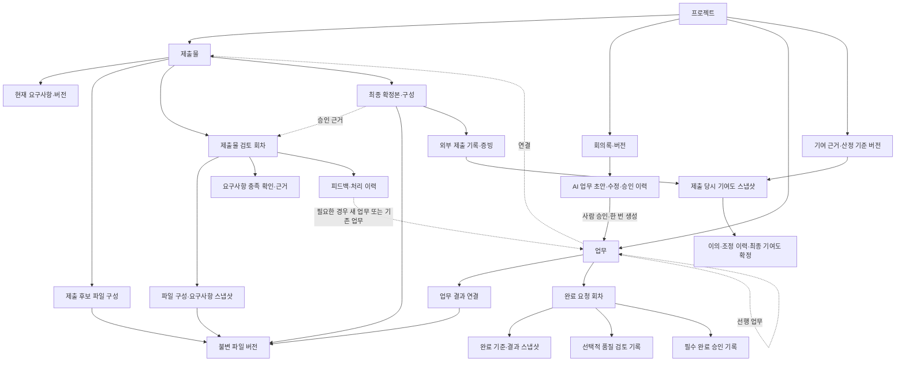
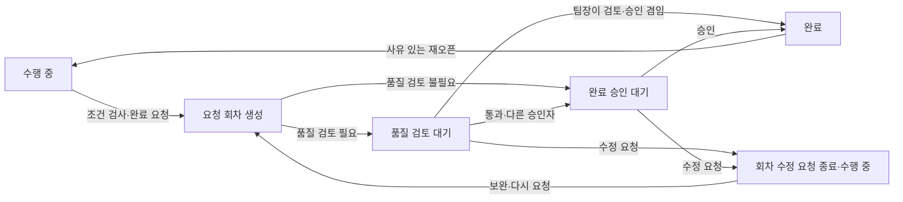
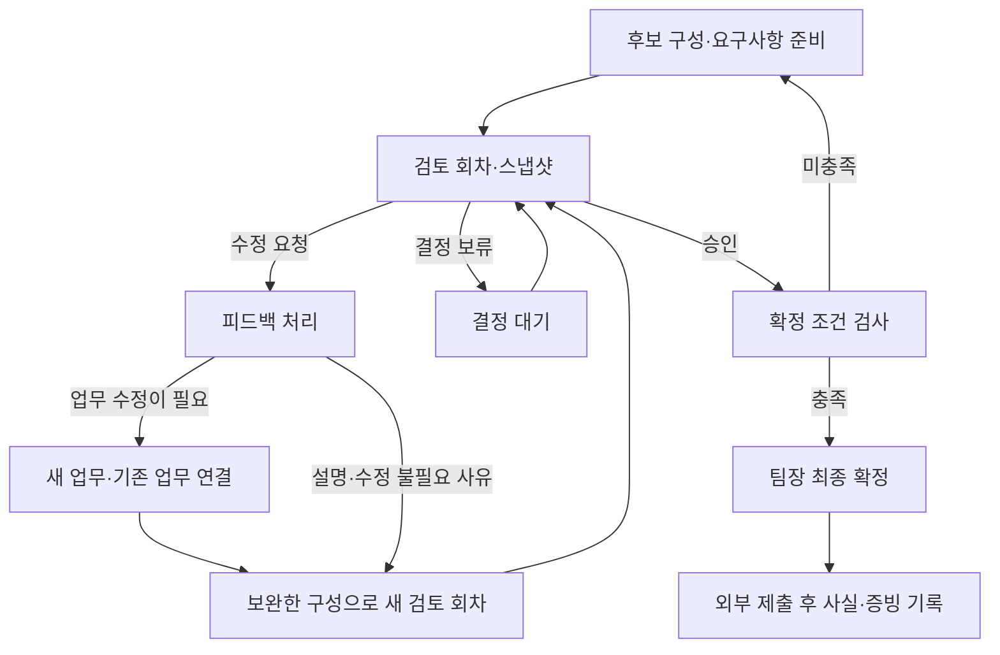

# 대학생 PMS 아티팩트 관계·상태 전환 통합 설계

> 2026-10-12 후속 사용자 결정: 아래의 ‘모든 업무 팀장 승인 + 선택적 품질 검토’는 초기 설계다. 현재 별도 UI는 **결과 단위 업무를 다른 팀원 한 명이 확인하면 완료하고, 팀장은 최종 제출물을 확정**하는 흐름으로 수정했다. 최신 구현 범위·권한·제한은 [TASK_RESULT_UX.md](TASK_RESULT_UX.md)를 따른다. 아래 장기 데이터 관계 제안은 계약 검토 전이며 모두 구현된 것은 아니다.

- 작성일: 2026-10-12 / 작성: 손정협(B) 작업 범위의 설계 초안
- 상태: DRAFT — 사용자 흐름 반영, A·C 계약 검토 전. 구현 완료 문서가 아니다.
- 코드 기준: `C:/blackbox/teamplay-ui`, `codex/ui-flow-redesign`, HEAD `98d073b` 및 현재 미커밋 변경. 루트 `C:/blackbox`나 원격 최신 main의 구현 상태를 뜻하지 않는다.
- 요청 범위: 기존 아티팩트를 유지하면서 회의 AI 초안부터 업무·검토·제출·기여도까지 관계와 조건을 일치시킨다. 이번 변경은 설계 문서이며 새로운 DB/API를 적용하지 않는다.

## 1. 제품 흐름과 책임

사용자는 전공과 관계없이 공동 과제를 제출하는 2~4인 대학생 팀이다. 제출물과 마감을 먼저 정하고, 요구사항을 업무로 나누어 수행한다. 중간 검토는 작업 중에도 가능하며, 모든 업무가 끝나야만 검토를 시작하는 구조는 아니다.

기본 흐름은 `제출물·요구사항 설정 → 업무 배정·수행 → 결과 등록·완료 요청 → 필요한 품질 검토·완료 승인 → 제출물 구성 검토 → 최종 확정 → 외부 제출 기록`이다. 회의록에서 추출한 업무 초안은 사람이 확인한 뒤 이 흐름에 합류한다.

세 절차의 의미를 구분한다.

| 절차 | 확인 대상 | 적용 | 결정 권한 |
| --- | --- | --- | --- |
| 업무 완료 승인 | 약속한 범위와 완료 기준을 수행했는가 | 모든 업무 | 팀장. 팀장 본인 업무는 다른 팀원에게 승인 위임 |
| 업무 품질 검토 | 특정 결과가 품질 기준을 충족하는가 | 검토 필요로 지정한 업무 | 지정 검토자 |
| 제출물 검토·확정 | 제출 파일 전체와 필수 요구사항이 충족되는가 | 제출물 | 검토자 승인 후 팀장 최종 확정 |

팀장이 품질 검토자와 완료 승인자를 겸하면 `검토 통과 및 완료 승인` 한 번으로 두 기록을 남긴다. 검토자가 다른 사람이면 검토 통과 후 팀장에게 승인할 항목을 보여 준다. 담당자에게 다시 완료 요청을 누르게 하지 않는다. 업무 승인은 제출물 승인을 대신하지 않는다.

## 2. 실제 구현과 보완 범위

아래는 위 작업 폴더의 소스 확인 결과다. 기존 main 기반 기능과 별도 UI 작업을 구분한다. 전체 기능의 실제 실행을 이번 문서 작성 과정에서 다시 검사한 것은 아니다.

| 영역 | 현재 코드 | 보완할 관계·기록 |
| --- | --- | --- |
| 회의 AI | 별도 UI에서 후보 추출·수정·선택 후 업무 생성. 후보는 화면 임시 상태, 회의 출처는 설명에 기록 | 서버 초안 보존, 회의록 버전, 수정·승인 이력, 생성 업무 FK |
| 업무 결과 | 별도 UI의 `TaskFile`이 업무와 정확한 파일 버전 ID 연결 | 완료 요청 당시 결과 구성 스냅샷, 파일 외 결과 근거 |
| 업무 완료 | 별도 UI의 `TaskWorkflowService`가 조건 검사·팀장 승인 후 DONE 허용 | 회차별 불변 기록, 선택적 품질 검토, 본인 업무 승인 위임 |
| 제출물 파일 | 업무 파일을 모아 조회, 검토 회차는 파일 하나 선택 | 편집 가능한 제출 후보 구성과 여러 파일의 버전 선택 |
| 제출물 검토 | 기존 `ReviewRound`가 특정 파일 버전과 결정 보존 | 여러 파일 구성·요구사항의 회차별 스냅샷 |
| 피드백 | 기존 해결·재오픈, 새 업무 생성 및 연결 | 기존 업무 연결, 처리 사유와 상태 전환 이력 |
| 요구사항 충족 | 기존 현재 확인자·시각 저장, 내용 변경 시 확인 해제 | 검토 대상 요구사항 버전·근거·회차에 연결된 확인 이력 |
| 확정·제출 | 기존 `DeliverableConfirmationService`가 최종 확정 및 제출 사실 기록 | 확정 파일 구성, 제출 증빙 연결 |
| 기여도 | `ScoreService`가 업무·회의·파일·액션 참여 여부를 재계산해 현재 행 갱신 | 제출 시점 집계 보존, 기준 버전, 이의·조정·확정 이력 |

현재 업무 승인 필드는 Task에 있으므로 재오픈하면 현재 승인 값이 지워진다. 활동 로그가 있어도 회차별 승인 아티팩트와 동일하지 않다. 또한 현재 팀장 본인 업무 승인이 허용되므로 위임 정책은 후속 구현 사항이다.

## 3. 통합 관계도

점선은 출처·근거 연결이다. 아래 명칭은 개념 모델이며 확정 테이블 이름이나 새 계약 번호가 아니다.

파일을 여러 곳에 복사해 저장하지 않고 동일한 불변 파일 버전 ID를 참조한다. 후보·검토·확정은 각각 구성 항목을 보존한다. 프로젝트 자료 목록은 원본을 찾는 보조 화면이며 업무 결과와 제출 후보 선택은 해당 상세 화면에서 한다.

## 4. 최소 기록 모델

| 기록 | 반드시 남길 내용 | 변경 원칙 |
| --- | --- | --- |
| AI 초안 | 회의·회의록 버전, 원문 근거, 추출 내용, 모델 식별 정보, 생성 시각, 수정본·수정자, 승인/제외자, 생성 업무 ID | 생성 원안 보존. 원문 변경 시 기존 초안에 경고하고 재확인. 승인과 업무 생성은 중복 방지 |
| 업무 설정 | 제출물·요구사항 연결, 담당자, 기한, 완료 기준, 선행 업무, 파일 필수 여부, 품질 검토 필요 여부·검토자 | 검토 설정은 완료 요청 전 지정. 요청 후 기준을 바꾸면 기존 요청을 종료하고 새 회차 |
| 완료 요청 회차 | 회차 번호, 요청자·시각, 기준 스냅샷, 결과 파일 ID/버전 또는 실행 근거, 검토·승인 대상 | 과거 대상 덮어쓰기 금지 |
| 품질 검토 | 요청 회차, 검토자·결정·사유·시각, 검토 대상 | 해당 요청 결과에만 유효 |
| 완료 승인 | 요청 회차, 승인자·시각·결정·사유, 위임자·범위 | 품질 검토와 분리. 동일 버튼 처리 시 하나의 트랜잭션 |
| 후보 구성 | 제출물, 구성 개정 번호, 파일 버전 ID, 표시 순서·역할 | 편집 가능. 파일 버전 자체는 변경 불가 |
| 제출물 검토 스냅샷 | 후보 구성 개정, 파일 항목 전체, 요구사항 내용·필수 여부·버전 | 회차 생성 시 고정 |
| 충족 확인 | 대상 요구사항 버전·검토 회차, 확인자·시각, 근거 파일/설명, 확인·철회 기록 | 새 요구사항 내용에 이전 확인 자동 재사용 금지 |
| 피드백 처리 | 회차·대상, 상태, 처리자·시각·사유, 연결 업무, 해결·재오픈 이벤트 | 새/기존 업무 연결 또는 수정 불필요 사유. 완료 업무와 해결 판정 분리 |
| 최종 확정본 | 승인 회차, 확정 구성, 요구사항 확인 근거, 확정자·시각 | 이후 파일 업로드로 대상 변경 금지 |
| 제출 기록 | 확정본, 외부 경로·제출 시각·기록자, 선택적 증빙 파일/접수 정보 | 학교 실제 접수와 PMS 기록 구분. 정정은 새 기록으로 남김 |
| 기여도 스냅샷 | 제출 기록, 집계 대상 기간·근거·기준 버전·계산 시각·결과 | 제출 당시 값 불변. 이후 조정은 별도 결과 |

초기 UI에는 품질 검토 필요 여부와 검토자만 추가한다. 완료 승인 필수 여부를 업무마다 설정하는 옵션은 두지 않는다. 선행 업무는 현재 한 개 모델을 유지하며 복수 의존 그래프는 별도 요구가 생길 때 확장한다.

## 5. 상태 전환

### 업무와 완료 요청

업무는 `TODO → IN_PROGRESS → DONE`을 유지한다. 승인 대기는 요청 회차의 상태이며 영구적인 업무 상태를 늘리지 않는다.

- 완료 요청에 파일 필수·완료 기준·승인된 선행 업무를 검사한다. 품질 검토 필수 업무는 유효한 통과 기록 없이는 DONE 불가.
- 검토 중 결과 v2를 v3로 바꾸려면 현재 요청을 변경 종료 처리하고 새 요청 회차를 연다. v2의 승인 기록은 남지만 v3에 적용되지 않는다.
- 재오픈은 이전 승인 삭제가 아니라 새 수행 및 요청 회차의 시작이다. 진행 중인 후행 업무가 있으면 현재처럼 재오픈을 막고 영향 조정 후 수행한다.
- 팀장 본인 업무는 다른 MEMBER에게 해당 업무의 완료 승인을 위임한다. 위임자는 본인 승인 권한을 동시에 행사하지 않으며 실제 승인자와 위임 근거를 남긴다. 다른 승인자가 없으면 완료 승인 대기로 남기고 우회 완료하지 않는다.
- 관찰자는 읽기 전용을 유지한다. 멘토 검토가 필요하면 관찰자 권한을 몰래 확장하지 않고 별도 권한 계약을 먼저 정한다.

### 제출물·피드백

보류는 초기에는 결정 전 상태와 사유로 표현한다. 수정 업무를 자동 생성하지 않는다. 검토를 바로 통과하면 수정 단계 없이 확정 조건 검사로 간다. 기존 K-10 결정 값에 HOLD를 임의 추가하지 않는다.

피드백은 기존 `OPEN → REFLECTION_PENDING → RESOLVED` 의미를 유지한다. 업무 없이도 사유를 남기고 해결할 수 있다. 업무가 DONE이어도 피드백을 자동 해결하지 않는다. 재오픈하면 새 이벤트를 남긴다. 승인된 회차는 코멘트 변경을 잠그고 추가 의견은 새 회차에서 받는다.

## 6. 제출물 승인·확정·제출 조건

1. 검토 승인: 현재 회차의 대상이 고정돼 있어야 하며 미해결 피드백이 0건이어야 한다. 파일 업로더 본인 승인을 막는 기존 원칙을 유지한다. 여러 파일이면 모든 대상 파일의 업로더를 기준으로 검사한다.
2. 최종 확정: 현재 후보 구성·요구사항 개정과 일치하는 최신 회차 승인, 필수 요구사항별 유효한 충족 확인, 제출물의 미해결 피드백 0건, 제출 파일 구성 존재를 모두 서버에서 확인한다.
3. 후보 파일 또는 요구사항이 바뀌면 과거 승인·확인을 삭제하지 않고 현재 확정 근거에서 제외한다. 새 회차에서 재검토·재확인한다. 초기에는 변경 영향 추측 없이 새 스냅샷 전체를 확인한다.
4. 업무 완료율 100%를 제출물 승인으로 취급하지 않는다. 연결 업무 중 제출에 필수인 미완료 업무를 차단할지는 추가 정책으로 검토하며 현재 계약에 없는 조건을 자동 추가하지 않는다.
5. 최종 확정 이후 내용은 잠근다. 후속 버전은 확정본을 바꾸지 않는다. 재확정·제출 정정 기능은 기존 기록 보존 정책 및 A 계약 합의 후 추가한다.
6. 외부 제출 기록은 확정본에만 연결한다. 증빙은 선택적으로 붙이고 증빙 없는 기록을 실제 접수 완료가 검증됐다고 표시하지 않는다. LMS 자동 제출은 범위 밖이다.

여러 파일의 업로더 합집합이 팀원 전체이면 기존 본인 파일 승인 금지로 최종 검토가 막힐 수 있다. 이 경우 정책은 **미합의**다. 파일별 상호 검토를 인정할지 별도 검토자를 허용할지 A·B·C가 결정해야 하며 우회 승인을 구현하지 않는다.

## 7. 기여도와 이력 보존

현재 참여 여부 판정을 곧바로 공정한 기여 비율이라고 표현하지 않는다. 완료 업무, 결과 제출, 검토 활동, 회의 참석을 근거로 제공하되 산정식·분모·대상 기간을 먼저 합의한다.

- 동일 업무의 품질 통과와 완료 승인을 수행자의 성과로 중복 가산하지 않는다. 검토자의 활동은 별도 근거다.
- 재오픈·재승인 횟수가 많다는 이유로 업무 성과를 반복 가산하지 않는다. 업무 ID와 산정 기준 버전으로 중복을 방지한다.
- 제출 기록 생성 시 해당 제출물 관련 근거와 제출 당시 프로젝트 집계 범위를 명시한 스냅샷을 함께 남긴다. 주차별 제출 때 전체 프로젝트 기여도를 의미하는지 해당 제출물 기여도인지 화면에서도 구분한다.
- 이후 이의는 대상 근거·신청자·사유·증빙으로 기록한다. 조정자는 원값·조정값·사유를 남기고 당사자 본인의 단독 확정을 허용하지 않는다. 구체적인 조정·최종 확정 권한은 B 계약에서 합의한다.
- 원 제출 스냅샷과 조정된 최종 결과를 나란히 조회한다. 과거 제출 시점 값은 다시 계산해 덮어쓰지 않는다.
- 현재 참석률 계산은 기존 checked-in 집계를 사용한다. PRESENT/LATE/ABSENT와 과거 LEGACY 기록을 산정식에 어떻게 반영할지 먼저 정해야 한다. 지각을 자동 불참으로 취급하지 않는다.

## 8. 화면 연결

네비게이션은 `프로젝트 홈 / 제출물 / 업무 / 회의`를 유지한다. 기록별 화면을 메뉴로 계속 늘리지 않는다.

| 화면 | 사용자가 하는 일 | 다음 행동 |
| --- | --- | --- |
| 제출물 상세 | 요구사항·관련 업무·후보 파일 구성 확인 | 업무 열기, 중간 검토, 최종 확정 |
| 업무 상세 | 순서·완료 기준·파일 필수·품질 검토 지정, 결과 업로드 | 완료 요청 한 번, 품질 검토·승인 결과 확인 |
| 회의 상세 | 회의록 작성, AI 후보 수정·승인·제외 | 제출물·담당자를 정해 업무 생성 |
| 검토 영역 | 회차의 파일·요구사항 고정 대상과 피드백 확인 | 승인 또는 수정 요청, 기존/새 업무 연결 |
| 제출물 확정 영역 | 차단 조건과 확정본 확인 | 외부 제출 기록·증빙 등록 |
| 팀 활동 | 현재 참여 근거와 제출 시점 집계 확인 | 이의 제출·조정 이력 조회 |

버튼은 서버가 제공하는 허용 행동과 차단 사유를 따른다. 드래그로 DONE으로 옮겨도 승인 절차를 건너뛰지 못한다. 아직 없는 API의 저장 버튼을 활성화해 구현된 것처럼 보이지 않는다.

## 9. 담당 경계·계약 분할·구현 순서

공통 의미 변경은 기존 K-10·K-11·K-12·K-14·K-20의 개정으로 먼저 협의한다. 아래 작업명은 제안이며 팀 Task 번호·마이그레이션 번호를 예약하지 않는다.

| 순서 | A: 송승준 | B: 손정협 | C: 손정효 | 합의·검증 기준 |
| --- | --- | --- | --- | --- |
| 1. 공통 계약 | 파일 구성·검토·확정의 버전 의미 | 완료 회차·품질 검토·위임 의미 | 한 번의 요청·한 번의 결합 승인 화면 | 권한, null, 409, 중복 요청, 변경 무효화 fixture |
| 2. 업무 완료 기록 | B 엔티티 대응 SQL·번호 검토 | 현재 승인 로직을 요청 회차·불변 이력으로 확장 | 완료·검토 결합 UI | 직접 DONE 차단, 결과 교체 재검토, 본인 승인·위임 |
| 3. 제출 대상 고정 | 후보 구성·회차 스냅샷·충족 근거·확정 | 피드백 기존 업무 연결·처리 이력 | 제출물 상세에서 흐름 연결 | 구성 변경 후 옛 승인 차단, 확정 후 수정 차단 |
| 4. 회의 AI 출처 | DB·파일 근거 지원 검토 | 초안 보존·수정·승인·업무 생성 연결 | 초안 복구·출처 표시 | 새로고침 보존, 중복 생성 방지, 회의 버전 불일치 |
| 5. 제출·기여도 | 제출 증빙·스냅샷 호출 경계 | 기준 버전·집계 스냅샷·이의·조정 | 당시 값·조정 결과 구분 | 실패 시 제출/스냅샷 원자성, 중복 가산 방지 |

시연 우선은 1~3의 핵심 흐름이다. 회의 AI는 현재 기능을 유지하며 보존 관계를 단계적으로 추가한다. 기여도는 먼저 근거·제출 스냅샷을 정확히 제공하고 복잡한 가중 산식과 조정 UI는 일정 확인 후 확장한다. 10주 계획의 기능 동결·마지막 2주 검증 원칙은 유지한다.

현재 로컬 V25~V27은 A의 번호 조정·DB 검토가 필요한 변경이다. 이번 설계는 추가 번호를 사용하지 않는다. 타인 소유 코드·공통 계약을 이 문서만으로 변경하거나 AGREED 상태로 올리지 않는다.

## 10. 구현 검증 기준과 미결정

- 모든 관계에 프로젝트 경계를 검사하고 다른 프로젝트 ID는 404로 처리한다. 관찰자는 조회만 가능하고 직접 쓰기 요청도 차단한다.
- 승인·후보 변경·재오픈·최종 확정은 동일 대상에 대해 직렬화하거나 기대 버전을 검사한다. 요청 대상 개정이 다르면 409와 다시 확인할 사유를 반환한다. 잠금 순서를 통일해 교착을 방지한다.
- 결합 승인에서 품질 기록만 저장되거나 DONE만 반영되는 부분 성공을 허용하지 않는다. AI 승인→업무 생성, 제출→기여도 스냅샷도 중복 요청 식별과 원자성을 계약에 적는다.
- 파일 원본 불변성, 과거 데이터 보존, 기존 migration 무수정 원칙을 유지한다. 과거 요청·승인을 추측해 소급 생성하지 않고 legacy 표시한다.
- 단위 검증과 실제 PostgreSQL·인증 HTTP·브라우저 시나리오를 구분한다. 실제 테스트 전에는 통과로 기록하지 않는다.
- 필수 시나리오: 일반 업무 완료, 품질 검토 후 완료, 결합 승인, 수정 재요청, 결과 교체, 승인 위임, 기존 업무 피드백 연결, 직접 검토 통과 후 확정, 보류, 후보 변경, 요구사항 변경, 제출 기록과 당시 기여도 보존.

미결정: 여러 파일의 본인 승인 제한 방식, 기여도 산정 범위·산식·조정 확정 권한, 멘토 검토 권한, 재확정·제출 정정 정책. 해당 계약 담당자가 소비자와 합의한 뒤 구현한다.

이번 작성 검증은 코드 선언·관계 대조 및 문서 링크 확인이다. 새 설계의 실행 검사나 Mermaid 렌더링 검증은 수행하지 않았다.

## 관련 문서

- [업무 완료 승인 현재 구현](TASK_COMPLETION.md)
- [회의 AI 현재 구현](MEETING_OUTCOMES.md)
- [업무 파일·참석 현재 구현](ATTENDANCE_AND_TASK_FILES.md)
- [네비게이션](NAVIGATION.md)
- [K-10](../team/contracts/K-10-review-round.md), [K-11](../team/contracts/K-11-review-comments.md), [K-12](../team/contracts/K-12-feedback-task.md), [K-14](../team/contracts/K-14-requirement-assessment.md), [K-20](../team/contracts/K-20-confirmation-submission.md)
