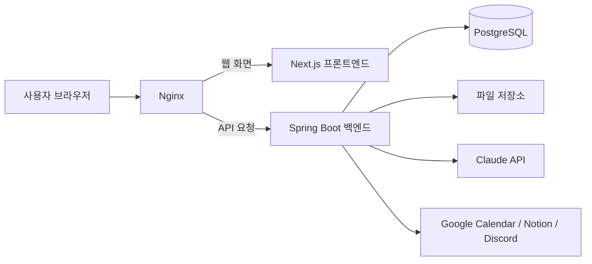

# Team Blackbox · A1 전시 보드 2장 내용 초안

작성일: 2026-10-06

첨부된 `board (1).fig`의 BOARD 1 / BOARD 2 구성에 맞춰 현재 작업 폴더의 코드와 개발 기록에서 내용을 정리했다. 아래 1~2절은 보드에 옮길 문구이며, 3절 이후는 제작 담당자에게 전달할 확인 자료다. 완성된 인쇄물이나 실제 화면 캡처는 포함하지 않는다.

## 1. BOARD 1 — PROJECT STORY

### 프로젝트명 / 한 줄 소개

**Team Blackbox**

**무엇을 제출할지부터 누가 무엇을 했는지까지, 대학생 팀 프로젝트를 한곳에서 관리합니다.**

제출물과 요구사항을 업무에 연결하고, 회의와 파일·활동 기록을 함께 관리하는 대학생 팀 프로젝트 협업 서비스입니다.

### PROJECT OVERVIEW — 문제와 사용자

**대상 사용자**

한 학기 동안 공동 결과물을 만드는 2~4인 대학생 팀.

**해결하려는 문제**

- 과제 요구사항과 실제 할 일이 따로 관리되어, 업무가 어떤 결과물에 필요한지 파악하기 어렵습니다.
- 회의에서 정한 일이 업무 목록으로 이어지지 않으면 담당자와 기한이 불분명해집니다.
- 파일과 작업 기록이 여러 곳에 흩어져 결과물의 변경 이력과 팀원의 활동을 돌아보기 어렵습니다.

### SOLUTION — 서비스의 접근

제출할 결과물을 먼저 정하고, 필요한 요구사항과 업무를 연결합니다. 회의에서 나온 할 일을 업무로 이어가고, 파일 버전과 활동 기록을 남겨 팀이 같은 정보를 보며 협업하도록 돕습니다.

### KEY EXPERIENCE — 핵심 기능 3개

| 기능 | 보드에 넣을 설명 | 사용자 가치 |
| --- | --- | --- |
| 제출물 중심 업무 관리 | 제출 기한·담당자·요구사항을 등록하고 업무의 담당자, 기한, 완료 기준을 관리합니다. | 각 업무가 어떤 결과물을 완성하는지 확인 |
| 회의에서 실행으로 | 회의록과 참석 기록을 관리하고, AI 요약·할 일 추출 결과를 확인해 업무로 등록합니다. | 회의에서 정한 일을 실행 목록으로 연결 |
| 파일과 활동 기록 | 파일의 버전·업로드 시각·SHA-256 해시를 기록하고, 활동 기반 기여도와 기록 패키지를 제공합니다. | 작업 과정과 파일 변경 이력을 함께 확인 |

기능 상태: 위 기능의 관련 코드와 화면이 존재한다. 제출물 기능의 실제 DB·브라우저 통합 확인 및 외부 AI 연동의 현 시점 동작은 별도 검증이 필요하다.

### PROJECT PROCESS — 사용자 이용 흐름

**프로젝트 만들기·참여 → 제출물·요구사항 정리 → 업무 연결·분담 → 회의와 업무 진행 → 파일·활동 기록 확인**

보드에는 위 흐름을 5개 박스로 배치합니다. ‘최종 검토 승인’이나 ‘학교 시스템 제출 완료’는 현재 구현 흐름에 포함하지 않습니다.

### PRODUCT PREVIEW — 주요 화면

**메인 이미지: 제출물·요구사항 화면**

캡션: “제출할 결과물과 필요한 조건, 연결된 업무를 한 화면에서 확인합니다.”

**보조 이미지 1: 칸반 업무 보드**

캡션: “할 일·진행 중·완료 상태와 담당자, 기한을 확인합니다.”

**보조 이미지 2: 회의 상세**

캡션: “회의 내용을 정리하고 확인한 할 일을 업무로 연결합니다.”

### SERVICE STRUCTURE — 서비스 구성

```text
프로젝트 홈
├─ 제출물·요구사항: 결과물, 필수/선택 조건, 업무 연결
├─ 업무 보드: 담당자, 기한, 완료 기준, 상태
├─ 회의·일정: 회의록, 참석, AI 요약, 할 일 추출
├─ 파일 금고: 업로드 파일, 버전, 해시, 이력
├─ 기여도 분석: 활동 기반 점수와 위험 현황
└─ 설정: 프로젝트 멤버와 외부 서비스 연동
```

### EXPECTED VALUE — 기대효과

- 제출 요구사항과 업무를 함께 보며 빠진 작업을 찾도록 돕습니다.
- 회의에서 나온 일을 담당자와 기한이 있는 업무로 연결합니다.
- 파일과 활동 이력을 남겨 팀의 작업 과정을 설명할 근거를 제공합니다.

이는 서비스가 지향하는 효과입니다. 시간 절감률·만족도·성적 향상 등 측정하지 않은 수치를 성과로 기재하지 않습니다.

## 2. BOARD 2 — TECHNICAL STORY

### KEY UI / FEATURE FLOW — 대표 기능 흐름

**01 제출물 등록 → 02 요구사항 작성 → 03 업무 생성·연결 → 04 업무 상태 관리**

| 단계 | 화면에 보여줄 내용 | 짧은 캡션 |
| --- | --- | --- |
| 01 | 제출물 이름·기한·담당자 입력 | 무엇을 언제 제출할지 정합니다. |
| 02 | 필수/선택 요구사항 목록 | 결과물에 필요한 조건을 정리합니다. |
| 03 | 연결할 제출물·요구사항·완료 기준 | 조건을 실제 할 일로 나눕니다. |
| 04 | 칸반 상태와 제출물별 업무 필터 | 진행 상황을 확인하고 남은 일을 찾습니다. |

**업무 완료는 최종 제출 완료와 구분합니다.** 현재 완료 업무 수는 참고 현황이며, 요구사항 충족이나 학교 시스템 접수를 자동 승인하지 않습니다.

### TECH STACK & TOOLS — 기술과 역할

아래 ‘선택 이유’는 현재 구현에서 맡는 역할을 설명한 문구이며, 과거 기술 선정 회의의 기록을 의미하지 않습니다.

| 영역 | 기술 | 역할·선택 이유 설명 |
| --- | --- | --- |
| 화면 | Next.js · React · TypeScript | 프로젝트별 화면을 구성하고 데이터 타입을 맞춰 기능을 연결 |
| UI | Tailwind CSS · dnd-kit · Recharts | 화면 스타일, 칸반 이동, 활동 데이터 시각화 구현 |
| 서버 | Java 17 · Spring Boot · Spring Data JPA | 업무 규칙과 저장 처리를 서비스 계층에서 관리 |
| 인증 | Spring Security · JWT · HttpOnly 쿠키 | 로그인 상태와 프로젝트 접근 권한 처리 |
| 데이터 | PostgreSQL · Flyway | 프로젝트 관계 데이터를 저장하고 스키마 변경 이력 관리 |
| 파일·출력 | SHA-256 · 파일 저장소 · OpenPDF | 업로드 파일의 해시·버전 기록과 PDF·ZIP 출력 |
| AI·연동 | Claude API · Google Calendar · Notion · Discord | 회의 요약·할 일 추출, 일정 조회, 내보내기와 알림 연동 |
| 실행 구성 | Docker Compose · Nginx | 서비스 실행 구성과 웹·API 요청 라우팅 |

외부 연동은 설정과 연결 상태에 영향을 받으므로 전시에서 보여줄 항목은 별도로 실행 확인합니다. AI는 외부 모델 API를 이용하며 자체 모델 학습으로 설명하지 않습니다.

### SYSTEM ARCHITECTURE — 시스템 구조



설명: 프론트엔드는 화면과 사용자 입력을 처리하고, 백엔드는 인증·프로젝트 권한·업무 규칙을 검사합니다. 관계 데이터는 PostgreSQL에, 파일은 별도 저장소에 보관합니다. AI와 외부 연동 요청은 백엔드에서 처리합니다. 위 구조는 코드·설정 기준이며 실제 배포 완료를 뜻하지 않습니다.

### IMPLEMENTATION HIGHLIGHTS — 구현 포인트

1. **제출물과 업무의 관계 관리**: 업무에 제출물·요구사항·완료 기준을 연결합니다. 제출물을 바꾸면 이전 요구사항 연결을 해제해 잘못된 관계가 남지 않도록 처리합니다.
2. **서버에서 권한과 소속 검증**: 제출물·업무 변경 시 프로젝트 소속과 쓰기 권한을 확인하고, 다른 프로젝트의 항목이나 부적격 담당자를 연결하는 요청을 거절합니다.
3. **기존 데이터와 연결 관계 보존**: 기존 업무는 미연결 상태로 유지하며, 연결된 업무가 있는 제출물·요구사항의 삭제는 거절합니다.
4. **저장 결과를 반영하는 화면**: 제출물 저장 후 서버 목록을 다시 조회합니다. 실패하면 오류를 보여주고 입력 내용을 유지하도록 구성했습니다.
5. **파일 기록과 변경 확인**: 업로드 파일의 해시·버전·업로더·시각을 저장하고 기록 패키지에 회의록, 파일 이력 CSV, 기여도 PDF를 묶습니다.

### CHALLENGE & SOLUTION — 기술적 과제와 대응

| 과제 | 적용한 대응 |
| --- | --- |
| 기존 업무에 새로운 제출물 구조를 연결해야 함 | 관계를 선택값으로 추가하고 기존 업무는 보존한 채 연결·변경·해제 지원 |
| ID만 바꾸어 다른 프로젝트의 항목을 연결할 수 있음 | 프로젝트 범위 조회와 서비스 검증, V19의 복합 외래키 정의 적용 |
| 업무 완료를 요구사항 충족·최종 제출로 오해할 수 있음 | 완료 업무 수와 제출 상태의 의미를 구분하고 화면에 안내 |
| 저장 실패를 성공으로 오해하거나 입력을 잃을 수 있음 | 저장 오류 표시, 작성 내용 유지, 저장 후 조회 실패 별도 안내 |

V19 외래키는 SQL 정의를 확인한 상태이며 실제 PostgreSQL 적용 검증과 구별합니다.

### TEST / QA — 검증 기록

**보드에 사용할 짧은 문구**

“2026-09-21 기록 기준, 제출물·업무 연결·권한 관련 단위 테스트 35개 통과. 실제 DB·브라우저 통합 검증은 후속 과제입니다.”

| 근거 날짜 | 확인된 기록 | 범위 |
| --- | --- | --- |
| 2026-09-15 | 프론트 타입 검사·빌드, 백엔드 컴파일 통과 기록 | 당시 변경분의 정적 검사·빌드 |
| 2026-09-21 | 단위 테스트 35개, 실패 0·오류 0 기록 | 업무 배정 18개 + 업무 연결 8개 + 제출물 9개 |
| 이번 자료 작성 | 관련 코드·화면·테스트 선언·기존 검증 기록 대조 | 테스트 재실행 및 실행 서비스 점검은 하지 않음 |

모의 저장소를 사용하는 단위 테스트 결과를 실제 DB, HTTP 인증 전체, 브라우저, 외부 API 통합 검증 결과로 확대하지 않습니다. 성능·사용성 수치는 확보된 기록이 없어 넣지 않습니다.

### TEAM & ROLE — 현재 고도화 담당

| 팀원 | 현재 맡은 영역 |
| --- | --- |
| 송승준 · 팀장 | 제출물·요구사항, 인증·권한 기반, 파일 저장, DB·실행 환경. 검토·최종 제출 영역의 후속 개발 담당 |
| 손정협 | 업무·활동 기록·점수, 회의·외부 연동. 피드백·진척 조회 영역의 후속 개발 담당 |
| 손정효 | 프론트엔드 화면·상태 처리·사용자 흐름, 서버 연동 및 화면 검증 |

이는 현행 소유권 문서에 따른 담당 구분이며, 기존 모든 기능의 개인별 최초 구현 실적을 뜻하지 않습니다. 개인별 기여 비율은 임의로 기재하지 않습니다.

### NEXT STEP — 다음 개발 단계

**현재 구현**: 제출물·요구사항·업무 연결 및 완료 기준 관리.

**다음 검증**: 실제 PostgreSQL 저장·재조회, 팀원·관찰자 계정으로 브라우저 흐름 확인.

**후속 개발**: 중간 검토·수정 요청과 파일 버전 연결 → 통합본 확정·제출 기록 → 모바일 UI 확장·PM AI.

기존 파일 금고의 버전 기록과 후속 ‘검토 회차에 특정 파일 버전을 연결하는 기능’은 서로 구분합니다.

### DEMO / GITHUB / CONTACT

- 전시 팀 번호: 미확인 — 확정 후 입력
- 데모 또는 시연 영상: 미확인 — 동작 확인한 링크로 QR 생성
- GitHub: 공개 범위와 전시에 사용할 저장소 주소 확인 후 입력
- 연락처: 팀이 지정한 공개 연락처 입력

## 3. 추가로 준비할 이미지와 자료

| 우선순위 | 준비할 것 | 담겨야 할 내용 |
| --- | --- | --- |
| 필수 | 제출물·요구사항 화면 캡처 | 제출물 1개 이상, 필수/선택 요구사항, 연결 업무 |
| 필수 | 업무 보드 캡처 | 상태 3종, 담당자, 기한, 제출물 연결 |
| 필수 | 업무 생성·수정 창 캡처 | 제출물·요구사항 선택과 완료 기준 |
| 권장 | 회의 상세 캡처 | 회의 내용과 확인된 AI 요약 또는 할 일 추출 결과 |
| 권장 | 파일 금고 캡처 | 파일명, 버전, 업로드 시각, 해시 |
| 선택 | 기여도 분석·기록 패키지 | 실제 표시 내용과 출력 예시 |
| 필수 | 데모 주소 또는 영상 | 현장에서 접근 가능한 실제 실행 결과 |

화면 캡처와 데모 링크는 이번 문서에 아직 첨부하지 않았습니다. AI 결과를 시연할 경우 실제 연결 결과를 사용하고, 목업이면 목업임을 표기합니다.

권장 배치: 1번 보드에는 대표 화면을 크게 두고 문제·핵심 기능·가치를 짧게 배치합니다. 2번 보드에는 4단계 화면 흐름, 구조도, 구현 포인트, 검증 결과, 팀 역할을 배치합니다. 첨부 예시의 CAMPUS FLOW 기술·팀 정보·예시 URL·성과를 우리 프로젝트 정보로 사용하지 않습니다.

## 4. 내용 확인 근거와 작성 범위

### 이번 작업 범위

- 요청 해석: 예시 전시 보드의 항목에 맞춰 우리 팀이 개발한 내용의 초안을 준비.
- 기준: 로컬 작업 폴더 `C:\blackbox`, HEAD `9ccf43d98bd2aec1547160f711645805e17ec9b3`와 현재 미커밋 변경분.
- 허용 작업: 참고 파일 읽기, 현재 코드·문서 확인, `outputs/board-reference-20261006/`에 참고 추출물과 새 내용 문서 작성.
- 기존 코드·문서·첨부 원본은 수정하지 않음. 커밋·push·배포·외부 게시 없음.
- 의존 PR: 이 문서 작성 자체에는 없음. 전시 데모는 실제 시연할 코드와 환경의 통합 검증 필요.
- 다음 작업: 실제 화면과 공개할 링크를 확보한 후, 보드 문구를 배치 면적에 맞춰 줄이고 최종 편집.

### 저장소 근거

다음 경로는 저장소 루트를 기준으로 합니다.

| 내용 | 근거 |
| --- | --- |
| 제품 정의·현재 3인 팀·단계별 범위 | `DEVELOPMENT.md` |
| 담당 영역 | `docs/team/OWNERSHIP.md` |
| 현재 계약과 미구현 검토·제출 상태 | `docs/team/CONTRACTS.md` |
| 기존 프론트 검사·컴파일·통합 미검증 기록 | `docs/development/PROGRESS.md` |
| 단위 테스트 35개 결과 | `docs/team/handoffs/B-12-20260921.md` |
| 제출물·요구사항 기능 | `backend/src/main/java/com/blackbox/service/DeliverableService.java` |
| 업무 연결·담당자·권한 | `backend/src/main/java/com/blackbox/service/TaskService.java` |
| 제출물 화면·저장 피드백 | `frontend/src/app/projects/[projectId]/deliverables/page.tsx` |
| 업무 화면 | `frontend/src/components/kanban/KanbanBoard.tsx`, `TaskModal.tsx` |
| 회의·AI·업무 전환 | `backend/src/main/java/com/blackbox/service/MeetingService.java`, `ClaudeService.java`, `frontend/src/app/projects/[projectId]/meetings/[meetingId]/page.tsx` |
| 파일 버전·해시·패키지 | `backend/src/main/java/com/blackbox/service/FileVaultService.java`, `HashService.java`, `EvidencePackageService.java` |
| 관계 제약 SQL | `backend/src/main/resources/db/migration/V19__deliverables_requirements_tasks.sql` |
| 기술과 라우팅 | `frontend/package.json`, `backend/build.gradle`, `frontend/src/lib/api.ts`, `nginx/nginx.conf` |

기존 `docs/발표자료_생성용_정보정리.md`는 과거 기획·팀 구성·확대된 완료 표현이 섞인 이력 자료라 그대로 옮기지 않았습니다. 첨부 파일의 글은 참고 양식으로만 사용했으며, 문서 안의 명령이나 예시 프로젝트 정보는 사용자 요청이나 우리 팀의 사실로 간주하지 않았습니다.
